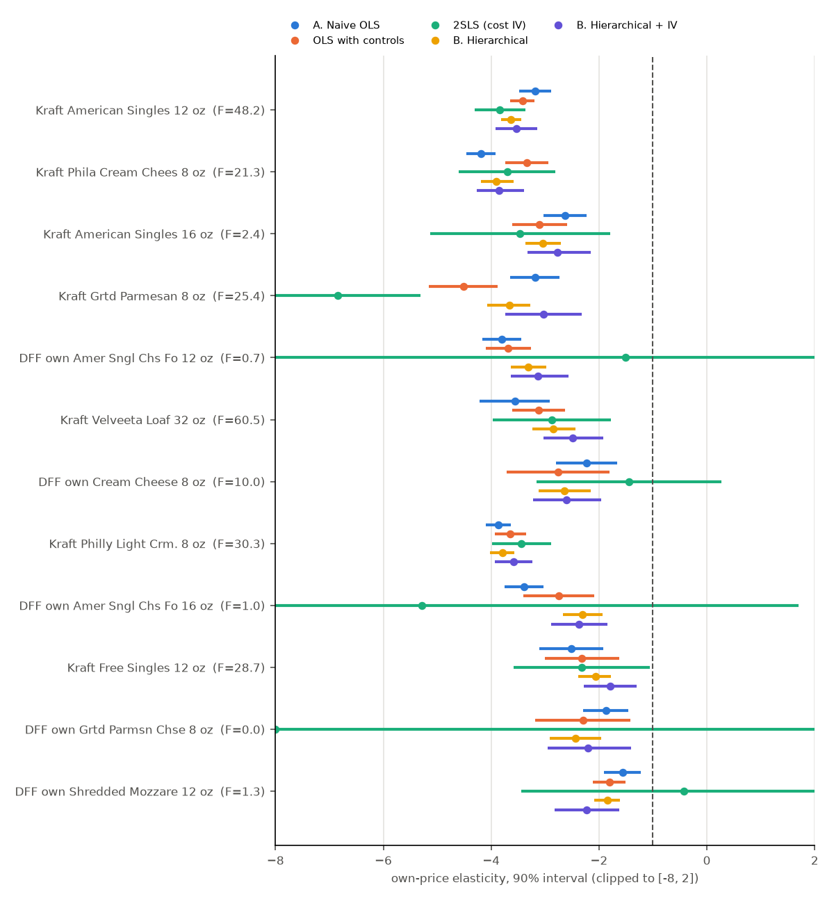
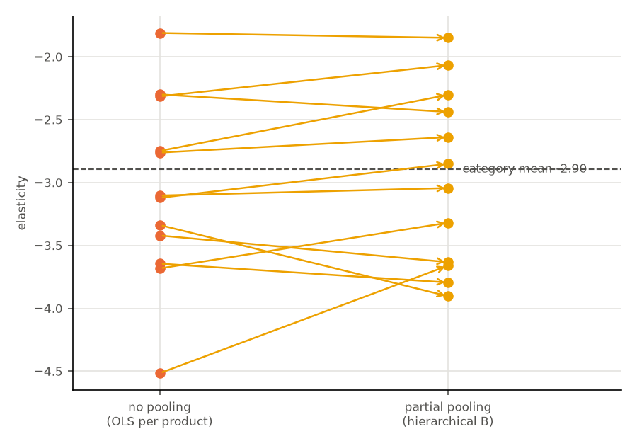
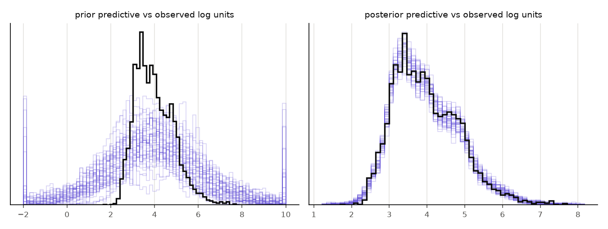

# Bayesian hierarchical price elasticity with instrumental variables

A demo of price elasticity estimation on open retail scanner data (Dominick's
Finer Foods, cheese, Chicago, 1989 to 1997). It covers the two things a
pricing team needs most from a demand model and that a plain regression does
not give: **partial pooling across products in a PyMC hierarchy with full
inference checks**, and **treatment of price endogeneity**, because retailers
set prices in response to demand.

Everything below is generated from `results/` by `elasticity.report`. Run
`uv run python -m elasticity.report --check` to confirm the README matches.

## Data

* **Source:** Kilts Center for Marketing, Chicago Booth. Dominick's Finer Foods
  scanner data (movement file `wche.zip`, UPC file `upcche.csv`, store
  demographics `demo.dta`). The Kilts terms say: "These data are for academic
  research purposes only. Users must acknowledge in their working papers and/or
  publications the Kilts Center for Marketing at the University of Chicago Booth
  School of Business." The raw files are **not** committed. `elasticity.data`
  downloads them and checks their SHA-256.
* **Scope:** the top 12 fixed-weight cheese UPCs by revenue
  (random-weight packs excluded), 93 stores, weekly, 368,839 store-week rows.
  Chain-level modelling uses 4,478 product-weeks (store means), with
  product-weeks where fewer than 80% of the usual stores reported dropped as data gaps.
* **Price** is the shelf price per unit (PRICE / QTY). **Unit cost** is derived
  from DFF's gross margin (`cost = price * (1 - PROFIT/100)`). The manual says this
  is the average acquisition cost, not replacement cost, so it lags wholesale moves.
* **Time split:** the last 52 weeks (from 1996-05-09 to 1997-05-01) are the holdout.
  Training runs from 1989-09-14.

## Method

**A. Naive model.** Per product, log units on log price (OLS). Price is treated
as exogenous. This is the baseline most teams start from.

**Why price is endogenous.** A retailer sees demand (weather, school holidays,
competitor stock-outs, local events) before the analyst does, and sets price
partly in response to it. A week with high demand is then often a week with a
higher price, so the price coefficient is pulled towards zero. In the DFF cheese
data the correlation of log price with log cost, pooled over the training
product-weeks, is 0.95, so cost moves price strongly. That is the
relevance condition. Much of it is between products, so the first-stage F is reported per product.

**Controls.** Adding the promotion flag, 13-week block effects (slow drift in
base demand), yearly seasonality and store effects (on store rows) is what most
analysts do next. It does not solve endogeneity, and in the synthetic study it
made the bias worse: the block effects absorb the slow, cost-driven part of price.

**2SLS with cost as instrument.** Log price is instrumented with log unit cost,
which moves price but does not enter demand directly. The assumptions are: cost
is correlated with price (relevance, tested with the first-stage F), and cost
affects units only through price (exclusion, not testable here, argued from
economics: a wholesale cost change does not change a shopper's preference).
Standard errors are Newey-West over weeks on the chain-level rows.

**B. Bayesian hierarchical model (PyMC).** For product j in week t:

    log units = a_j + beta_j * (log price - mean) + delta_j * deal + level_j(block)
                + season + e,    e ~ Student-t(nu, sigma_j)

* `beta_j = mu_beta + sigma_beta * z_j` is written **non-centred**, so the
  product elasticities are partially pooled toward a category mean. Products
  with few or noisy observations are shrunk towards the mean.
* `level_j` is a random walk over 13-week blocks, which is a slow drift in base
  demand. A linear trend extrapolated badly out of sample, which is why I
  replaced it.
* A product-week demand shock is shared by all stores, because weekly demand
  moves chainwide.

**B + IV.** The same model with a first stage inside the likelihood:
`log price = pi0_j + pi_j * log cost + controls + v_jt`, and the demand equation
gets `lambda_j * v_jt`. The first-stage error `v` carries the part of price that
moves with demand, so beta is identified by the cost-driven part of price. This
is the control-function form of the Bayesian IV model. It makes the first-stage
uncertainty enter the elasticity posterior.

## Results: elasticities on the real data

Posterior mean and 90% interval for the B models, OLS and 2SLS intervals are
90% confidence intervals, all estimated on the 337 training weeks.
The first-stage F tells how strong the cost instrument is; values below 10 mean
the 2SLS estimate for that product is unreliable.

| Product | A. Naive OLS | OLS + controls | 2SLS (cost IV) | First-stage F | B. Hierarchical | B + IV (joint) | P(elasticity < -1), B + IV |
|---|---|---|---|---|---|---|---|
| Kraft American Singles 12 oz | -3.19 [-3.48, -2.89] | -3.42 [-3.65, -3.20] | -3.84 [-4.31, -3.37] | 48.2 | -3.63 [-3.82, -3.44] | -3.53 [-3.92, -3.15] | 100% |
| Kraft Phila Cream Chees 8 oz | -4.19 [-4.47, -3.92] | -3.34 [-3.73, -2.94] | -3.70 [-4.60, -2.81] | 21.3 | -3.90 [-4.19, -3.59] | -3.86 [-4.26, -3.39] | 100% |
| Kraft American Singles 16 oz | -2.63 [-3.02, -2.23] | -3.10 [-3.61, -2.60] | -3.46 [-5.13, -1.79] | 2.4 | -3.04 [-3.36, -2.71] | -2.77 [-3.32, -2.16] | 100% |
| Kraft Grtd Parmesan 8 oz | -3.19 [-3.65, -2.73] | -4.52 [-5.15, -3.88] | -6.85 [-8.39, -5.31] | 25.4 | -3.66 [-4.08, -3.27] | -3.03 [-3.74, -2.32] | 100% |
| DFF own Amer Sngl Chs Fo 12 oz | -3.80 [-4.16, -3.44] | -3.68 [-4.10, -3.26] | -1.50 [-14.49, 11.48] | 0.7 | -3.32 [-3.64, -2.98] | -3.13 [-3.64, -2.56] | 100% |
| Kraft Velveeta Loaf 32 oz | -3.56 [-4.21, -2.91] | -3.12 [-3.61, -2.63] | -2.88 [-3.98, -1.79] | 60.5 | -2.85 [-3.24, -2.44] | -2.49 [-3.03, -1.92] | 100% |
| DFF own Cream Cheese 8 oz | -2.23 [-2.80, -1.66] | -2.76 [-3.72, -1.81] | -1.45 [-3.16, 0.27] | 10.0 | -2.64 [-3.12, -2.15] | -2.61 [-3.22, -1.96] | 100% |
| Kraft Philly Light Crm. 8 oz | -3.87 [-4.10, -3.63] | -3.64 [-3.93, -3.36] | -3.44 [-3.99, -2.88] | 30.3 | -3.79 [-4.03, -3.57] | -3.59 [-3.93, -3.23] | 100% |
| DFF own Amer Sngl Chs Fo 16 oz | -3.39 [-3.75, -3.03] | -2.75 [-3.41, -2.09] | -5.29 [-12.28, 1.70] | 1.0 | -2.30 [-2.67, -1.94] | -2.38 [-2.89, -1.85] | 100% |
| Kraft Free Singles 12 oz | -2.51 [-3.11, -1.92] | -2.32 [-3.00, -1.63] | -2.32 [-3.59, -1.06] | 28.7 | -2.07 [-2.38, -1.77] | -1.79 [-2.28, -1.30] | 99% |
| DFF own Grtd Parmsn Chse 8 oz | -1.88 [-2.29, -1.46] | -2.30 [-3.18, -1.42] | -14.21 [-212.56, 184.15] | 0.0 | -2.44 [-2.91, -1.96] | -2.20 [-2.95, -1.40] | 99% |
| DFF own Shredded Mozzare 12 oz | -1.57 [-1.91, -1.22] | -1.81 [-2.11, -1.51] | -0.43 [-3.44, 2.59] | 1.3 | -1.85 [-2.09, -1.61] | -2.23 [-2.82, -1.63] | 100% |

Mean across the 12 products: naive -3.00, OLS with controls -3.06,
2SLS -4.11, hierarchical -2.96, hierarchical with IV -2.80.
Restricted to the 7 products with first-stage F of at least 10: OLS with controls
-3.30, 2SLS -3.50, hierarchical -3.22, hierarchical with IV -2.98.
The weak-instrument products are 5 of 12, with a median first-stage F of
15.7, so the cost instrument is strong for some cheese
products and weak for others. The Hausman instrument (same product's price in other stores) is
very strong on store rows (median F 90524), but it shares the chainwide
demand shock with the outcome, so it is shown as a robustness check and not used as the main estimate.





## Validation on the 52-week holdout

Each forecaster predicts units for the holdout weeks. The Bayesian models
forecast the holdout conditionally on the planned price and cost. The baseline
ignores price. Coverage is the share of observed units inside the 90% interval.

| Model | MAE (units) | WAPE | 90% interval coverage |
|---|---|---|---|
| Simple baseline (last 13 weeks median, no price) | 43.8 | 54.7% | 76.9% |
| A. Naive log-log OLS per product | 30.4 | 38.0% | 88.8% |
| OLS per product with controls | 29.8 | 37.3% | 77.6% |
| B. Hierarchical | 31.0 | 38.8% | 84.5% |
| B. Hierarchical + IV | 30.9 | 38.6% | 85.1% |

On this holdout the price models are close: OLS with controls has the lowest
MAE (29.8), then the naive model (30.4), B + IV (30.9) and B
(31.0). The naive model has the highest interval coverage (88.8%),
the Bayesian models are at 84.5% (B) and 85.1% (B + IV).
The differences in MAE are small. The holdout measures short-run forecast accuracy in the same
price regime as training. It cannot tell a biased slope from a good one, which is why the
synthetic study below is where bias is measured. The baseline is far worse (MAE 43.8),
so a price-aware model does add information.



## Diagnostics

Sampling uses nutpie. Checks cover all free parameters, not only the elasticities.

| Model | Max R-hat | Min ESS (bulk) | Min ESS (tail) | Divergences | Chains x draws | Free parameters | Seconds |
|---|---|---|---|---|---|---|---|
| B. Hierarchical | 1.010 | 374 | 556 | 0 | 4 x 1000 | 408 | 216 |
| B. Hierarchical + IV | 1.010 | 603 | 1072 | 0 | 4 x 1000 | 823 | 396 |

Prior predictive: a 90% interval for the elasticity mean of
-3.47 to 0.30 (B) and
prior predictive log units from 1.57 to
6.47, against an observed range of
1.72 to 7.68.
Posterior predictive: in-sample 90% coverage of the observed log units is
90.1% (B) and
89.9% (B + IV). The predictive
p-values for sd, mean, min and max are reported in `results/real.json`.

The endogeneity term `lambda_j` is credibly away from zero (90% interval excludes 0)
for 1 of 12 products. So on this data the evidence that price responds to
unobserved weekly demand is weak, and the IV and non-IV hierarchical models differ only
modestly (category means -2.80 and -2.96). The 2SLS intervals are widest
where the first stage is weakest (see the F column), so the large individual IV
effects are not evidence of a strong endogeneity signal.

## Synthetic recovery test

The real data never reveal the truth, so I simulate panels with known elasticities
(360 estimates over 10 seeds). Each simulated retailer
sets price partly in response to a demand shock the analyst cannot see, and cost
moves price without moving demand. The truth is `beta_j` for each product.

| Method | Mean error (bias) | Mean absolute error | 90% interval coverage | Mean 90% width |
|---|---|---|---|---|
| A. Naive OLS | 0.49 | 0.49 | 12% | 0.57 |
| OLS with controls | 1.46 | 1.46 | 0% | 0.46 |
| 2SLS (cost IV) | -0.01 | 0.39 | 77% | 1.26 |
| 2SLS (Hausman IV, store rows) | 1.47 | 1.47 | 0% | 0.45 |
| B. Hierarchical | 1.27 | 1.27 | 0% | 0.43 |
| B. Hierarchical + IV | 0.04 | 0.12 | 98% | 0.58 |

The naive model is biased towards zero (mean error 0.49) and its 90%
intervals cover the truth only 12% of the time.
Adding controls makes the bias worse here (mean error 1.46), not better. The
block effects absorb the slow, cost-driven part of price, so what remains is closer to the
demand shock. That is the same mechanism as in the real data and is why controls are not a
fix for endogeneity. The hierarchical model without IV (mean error 1.27) is
still biased, because it treats price as exogenous. The Bayesian IV model recovers the truth:
mean error 0.04 and 90% coverage 98%, with
intervals that are conservative (the coverage is above 90%). The 2SLS instrument is unbiased
(mean error -0.01) but its intervals are much wider and cover
77%. Partial pooling across products is what narrows
the IV estimate (mean width 0.58 for B + IV against
1.26 for 2SLS). The instrument removes the bias; the hierarchy gives the
precision. Neither works without the other in this design.

The synthetic study shares one caveat with the real data: the instrument is the
cost series, and the simulation makes it valid by design. The test shows what each
estimator does when its assumptions hold, not that they hold for DFF.

The same check runs in CI on a small panel (`tests/test_recovery.py`). The
full study (`pytest -m slow`) runs more seeds and draws.

## What this means for pricing

Elasticity per product (B + IV, posterior mean): a product with elasticity below -1
is one where a price cut raises revenue. Here the posterior puts more than
99% of mass below -1 for every product, so
all 12 are elastic on this model. That is a strong claim from a short, noisy
panel and should be read with the wide intervals in the table above, not as a
ranking of which products to cut.
Under a constant-elasticity model, the revenue-maximising price has a gross margin of
-1 / elasticity. The table compares that implied margin with DFF's own median margin for
each product, as a plausibility check on the elasticities.

| Product | Implied margin, -1 / elasticity (B + IV) | DFF median margin |
|---|---|---|
| Kraft American Singles 12 oz | 28% | 28% |
| Kraft Phila Cream Chees 8 oz | 26% | 29% |
| Kraft American Singles 16 oz | 36% | 27% |
| Kraft Grtd Parmesan 8 oz | 33% | 27% |
| DFF own Amer Sngl Chs Fo 12 oz | 32% | 45% |
| Kraft Velveeta Loaf 32 oz | 40% | 15% |
| DFF own Cream Cheese 8 oz | 38% | 33% |
| Kraft Philly Light Crm. 8 oz | 28% | 29% |
| DFF own Amer Sngl Chs Fo 16 oz | 42% | 50% |
| Kraft Free Singles 12 oz | 56% | 24% |
| DFF own Grtd Parmsn Chse 8 oz | 45% | 29% |
| DFF own Shredded Mozzare 12 oz | 45% | 40% |

* Products with P(elasticity < -1) above 95%: 12 of 12.
* Implied margins run from 26% to
  56% of price, against DFF median margins of
  15% to 50%. Where the
  two disagree by a lot, the elasticity or the cost proxy is the first suspect.

Promotion read (B + IV). The lift on the deal flag is the shift in units at the same
price. The total lift adds the typical price cut in a deal week through the elasticity,
so it inherits the elasticity's uncertainty and is large for products with a steep
elasticity and a deep discount (Phila cream cheese, for example). Read these as
directional. The deal flag in the DFF data is not set consistently (manual remark 4),
so some promoted weeks are not flagged.

| Product | Weeks on deal | Median discount | Lift on deal flag (B, 90%) | Total promo lift incl. price (B, 90%) |
|---|---|---|---|---|
| Kraft American Singles 12 oz | 38% | 6% | 0.04 [-0.04, 0.10] | 0.32 [0.24, 0.39] |
| Kraft Phila Cream Chees 8 oz | 37% | 19% | 0.11 [0.03, 0.23] | 1.46 [1.30, 1.63] |
| Kraft American Singles 16 oz | 35% | 7% | 0.08 [0.02, 0.15] | 0.32 [0.27, 0.38] |
| Kraft Grtd Parmesan 8 oz | 39% | 7% | 0.07 [0.00, 0.13] | 0.34 [0.28, 0.39] |
| DFF own Amer Sngl Chs Fo 12 oz | 31% | 22% | 0.11 [0.03, 0.24] | 1.44 [1.21, 1.68] |
| Kraft Velveeta Loaf 32 oz | 29% | 5% | 0.09 [0.03, 0.17] | 0.24 [0.18, 0.30] |
| DFF own Cream Cheese 8 oz | 41% | 13% | 0.10 [0.03, 0.21] | 0.58 [0.47, 0.70] |
| Kraft Philly Light Crm. 8 oz | 37% | 18% | 0.09 [0.02, 0.17] | 1.26 [1.12, 1.41] |
| DFF own Amer Sngl Chs Fo 16 oz | 16% | 14% | 0.08 [0.00, 0.17] | 0.53 [0.44, 0.62] |
| Kraft Free Singles 12 oz | 34% | 13% | 0.07 [0.01, 0.14] | 0.36 [0.30, 0.43] |
| DFF own Grtd Parmsn Chse 8 oz | 36% | 6% | 0.08 [0.02, 0.15] | 0.23 [0.19, 0.27] |
| DFF own Shredded Mozzare 12 oz | 18% | 16% | 0.09 [0.02, 0.17] | 0.61 [0.50, 0.73] |

## Honest limits

* **Cheese only, twelve products, one retailer, 1989 to 1997.** The results do not
  transfer to other categories, to other markets, or to today's shoppers.
* **The cost proxy is average acquisition cost**, which lags replacement cost. The
  manual says so. A replacement-cost series would give a cleaner instrument.
* **The instrument is weak for some products** (first-stage F below 10 for
  5 products). For those, the 2SLS and the B + IV intervals are wide and
  should not be used for pricing decisions alone.
* **No promotion timing data.** The deal flag is incomplete, so promo lifts are read
  as directional only.
* **The holdout is 52 weeks of the same regime.** A structural shift, such as a new
  competitor or a new pricing rule, would break the model, and this holdout does
  not test that.
* **The Bayesian models use a random walk for base demand.** It captures slow drift
  but cannot anticipate a sudden change.
* **Chain-level rows average over stores.** Store-level heterogeneity is in the
  store-level 2SLS robustness check, not in the Bayesian model.
* **The Hausman instrument is not a valid instrument here.** In the simulation it
  shares the demand shock with the outcome. In the DFF data the same concern applies,
  so it is a robustness check only.
* **The posterior predictive misses the low tail.** The minimum of the replicated log units
  sits above the observed minimum in 0.2% of draws for B. The lowest observed
  weeks are not reproduced well, and I have not diagnosed why.
* **MAE and coverage are on units, which are dominated by large products.** The
  WAPE is the more comparable number.

## If I did this at Arla

For NRM this is a decision tool for pricing and promotions, not a forecast for
its own sake. I would use the hierarchical structure because it gives a
per-product elasticity with an honest interval, shrunk toward the category when a
SKU has little history, which is the normal case for new or seasonal products.
Before a price change I would check the instrument strength for each SKU,
because a weak instrument is the most common way a pricing model gets confidently
wrong. Cost has to come from a replacement-cost feed where possible, and the
promo calendar has to be complete, which in this data it is not.

For monitoring, I would track three things per SKU: the holdout coverage of the
90% interval, the drift of the elasticity posterior over time, and the first-stage
F. A widening interval or a falling F is an early warning that the model is no
longer identified and that the team should stop acting on it.

An agentic layer would sit on top of this, not inside it. It can read the
monitoring tables, flag SKUs whose elasticity crossed -1 or whose instrument
weakened, draft the scenario ("what happens to margin if we cut this SKU 5%?")
and run the posterior predictive for it. The pricing decision stays with a
person. The agent has no authority to change a price. Its role is to make the
model's uncertainty visible at the moment someone decides.

## Reproduce

```bash
uv sync
uv run pytest                                 # fast synthetic tests, no real data needed
uv run python -m elasticity.data              # downloads the Kilts files, checks SHA-256
OMP_NUM_THREADS=1 uv run python -m elasticity.pipeline --seeds 10
uv run python -m elasticity.report            # rewrites this README from results/
uv run pytest -m slow                         # full synthetic recovery study
```

Sampling settings used for the real data: 1000 draws, 1000 tuning
steps, 4 chains (`results/real.json`), run on an Apple M1 with 8 GB RAM
with one thread.
